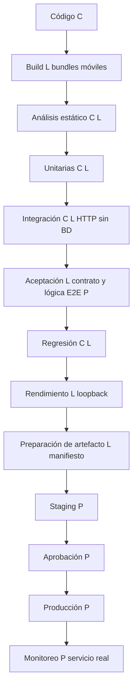

# Integración continua y liberación de La Pape Mobile

## Introducción

La Pape Mobile es una aplicación desarrollada con React Native, Expo y TypeScript para consultar productos de papelería desde dispositivos móviles. Su interfaz incluye Inicio, Catálogo y Detalle; el backend independiente utiliza Node.js y Express, con preparación para PostgreSQL en Neon. Analicé el repositorio para documentar cómo automatizo la integración, verifico sus componentes y preparo una liberación controlada (Expo, s. f.-d).

El estudio se basa en el commit 14a33cd de develop. Distingo el CI implementado en GitHub Actions, las pruebas y exportaciones ejecutadas localmente y el CD propuesto. Las comprobaciones HTTP se realizaron sin conexión a Neon. La Pape Rush es un videojuego separado y no integrado en este repositorio; los resultados que presento corresponden únicamente a Mobile.


## 1 Justificación del pipeline CI/CD

Elegí conservar GitHub Actions porque relaciona el código, las verificaciones y los reportes con una versión. Los locks hacen repetible la instalación; las puertas de calidad reducen errores antes de liberar. Separé la preparación de un artefacto de su aprobación y distribución para evitar que un resultado local se confunda con producción (GitHub, s. f.-b).

El workflow se activa por push y pull_request hacia main o develop y por workflow_dispatch. Usa ubuntu-latest, Node 22, checkout@v4, setup-node@v4, caché npm para los dos locks y permissions contents: read. Instala las dos aplicaciones con npm ci.

El job ejecuta node --check src/server.js mediante npm run check; este comando revisa ese archivo de entrada, no todos los archivos JavaScript. Ejecuta npm run test:ci en backend, ESLint con cero advertencias, tsc --noEmit, pruebas frontend e integración HTTP. TypeScript compila un subconjunto de servicios y utilidades en .test-build antes de las pruebas. No existe un paso de exportación Metro, APK/IPA, EAS Build ni despliegue en ese workflow.

Los reporteros nativos spec y junit producen logs y XML (Node.js, s. f.). El resumen usa resultados reales de los pasos, detecta XML ausentes y distingue omisiones y cancelaciones. El resumen y upload-artifact@v4 usan always(); las pruebas no se ocultan con continue-on-error. Los artefactos reportes-ci se retienen 14 días. El fallo intencional opcional se etiqueta como simulación y no demuestra un defecto real ni un despliegue.


Consulté la ejecución remota 7, run 39842793140 y job 120048062682, del PR 128. La página muestra Success y 47 s de duración total. Los logs corresponden al merge de prueba b82d20c del PR 128, asociado al head a0f02a8; lo distingo del commit base local. El runner usó Ubuntu 24.04.5 y Node 22.23.3.

Figura 1

Captura auténtica de la ejecución remota exitosa

[Consultar la ejecución auténtica en GitHub Actions](https://github.com/eduardohgo/La-Pape-Mobile/actions/runs/39842793140)

Nota. Captura obtenida en lectura el 25 de octubre de 2026. Fuente: https://github.com/eduardohgo/La-Pape-Mobile/actions/runs/39842793140. La captura se entrega en el PDF por separado. El repositorio incluye github-actions.json y github-actions-extracto.log con su procedencia. Las cuatro pruebas nuevas del worktree no forman parte de esta ejecución.

Figura 2

Flujo de liberación diseñado y alcance de cada etapa



Nota. C indica CI implementado; L, ejecución local; P, propuesta. El orden es mi diseño de liberación. El CI actual y el ensayo local tienen sus propios órdenes registrados; no presento el diagrama como una ejecución remota completa.

## 2 Entorno de liberación y despliegue

El CI utiliza un runner de GitHub Actions con Node 22. En la ejecución documentada el sistema fue Ubuntu 24.04.5 y Node 22.23.3. El entorno local de pruebas y exportación usó Windows, Node 24.21.0 y npm 11.19.0; falta comprobar paridad local bajo Node 22. Instalé las dependencias con npm ci --no-audit --no-fund en backend/ y frontend/, usando sus locks independientes.

La base HTTP mantiene /health sin BD y los indicadores comerciales deshabilitados. Los listeners de prueba se crean en 127.0.0.1 con puerto efímero y se cierran al terminar. Los ejemplos config/liberacion-local.ejemplo.yml y config/eas.ejemplo.json permanecen inactivos; staging, producción y CD son propuestas, no despliegues ejecutados.

### Liberación y rollback propuestos

Propongo un staging HTTPS separado, con datos de prueba autorizados. El backend usaría NODE_ENV=production porque su validador no admite staging; la app sí admite EXPO_PUBLIC_API_ENV=staging. El perfil de config/eas.ejemplo.json es conceptual y no se instaló. EAS Build podría generar binarios; EAS Update necesitaría expo-updates y compatibilidad de runtime; EAS Submit enviaría binarios firmados a las tiendas. No ejecuté esos servicios (Expo, s. f.-a, s. f.-b, s. f.-e).

Antes de promover exigiría pruebas aprobadas, aceptación móvil y revisión humana. Como trabajo individual registraría mi revisión sin presentarla como independiente. Conservaría el artefacto anterior y detendría la expansión ante fallos. Para backend propondría restaurar la versión anterior y verificar contrato y salud, sin revertir esquemas automáticamente. Para móvil, las correcciones JavaScript compatibles podrían distribuirse con EAS Update si se habilita; los cambios nativos requieren otro binario y los tiempos de tienda. Las aprobaciones de GitHub Environments siguen propuestas, sin configurar (GitHub, s. f.-a).

### Build de Android e iOS

Elegí Expo CLI y Metro porque el proyecto es Expo y debe transformar el código y assets para sus plataformas móviles. El proceso produce bytecode Hermes; separo esta exportación de la compilación y firma del runtime nativo. No es una evidencia de instalación o publicación (Expo, s. f.-c).

Para Build ejecuté desde frontend los equivalentes locales de npx --no-install expo export --platform android --max-workers 2 --output-dir ../docs/actividad4-ci-cd/artefactos/android y el mismo comando para ios. Usé el CLI instalado (Expo, s. f.-c), sin descargar otro mediante npx. Android terminó en 37.82 s e iOS en 37.35 s. Las salidas contienen bytecode Hermes .hbc, assets y metadata.json. El manifiesto registra 84 archivos y 8946887 bytes con SHA256. No son APK, AAB o IPA, no están firmados y no se instalaron en dispositivos.

El backend utiliza JavaScript ESM y no define un script build. Su preparación actual consiste en instalar dependencias, revisar sintaxis y ejecutar pruebas; no inventé un compilador. El ensayo configura EXPO_PUBLIC_API_URL=https://example.invalid y EXPO_PUBLIC_API_ENV=staging solo como valores públicos de empaquetado. Esa dirección no representa un staging desplegado y no recibe las cargas locales. EXPO_NO_DOTENV=1 evita cargar archivos privados; EXPO_OFFLINE=1 y EXPO_NO_TELEMETRY=1 limitan actividad del CLI.

Extracto 1

Salida literal de las exportaciones locales de Android e iOS

```text
ANDROID
032 node_modules\expo-router\assets\sitemap.png (465B)
033 node_modules\expo-router\assets\unmatched.png (4.8KB)
035 › android bundles (1):
036 _expo/static/js/android/entry-dfcf91fb9776819ed46d60e04c61b621.hbc (3.7MB)
038 › Files (1):
039 metadata.json (2.8KB)
041 Exported: ../docs/actividad4-ci-cd/artefactos/android

IOS
029 node_modules\expo-router\assets\sitemap.png (465B)
030 node_modules\expo-router\assets\unmatched.png (4.8KB)
032 › ios bundles (1):
033 _expo/static/js/ios/entry-919e3cdeaf89b40fd25f20be6b1d5eee.hbc (3.5MB)
035 › Files (1):
036 metadata.json (2.6KB)
038 Exported: ../docs/actividad4-ci-cd/artefactos/ios
```

Nota. Los prefijos numéricos indican líneas del log fuente, no salida adicional del build. Conservé ambos logs originales. El manifiesto liberacion-local.json permite verificar los hashes y 8 946 887 bytes de las exportaciones; no es una firma criptográfica.

El log remoto de instalación reportó una vulnerabilidad moderada en backend y 27 avisos en frontend en esa ejecución histórica. No ejecuté npm audit en esta revisión ni modifiqué dependencias. Esos avisos no son un diagnóstico vigente completo, y el CI exitoso no certifica ausencia de vulnerabilidades.

### Pruebas unitarias

El YAML existente ejecuta npm run test:ci desde backend y frontend. Los scripts usan Node Test Runner con reporteros spec y junit; TypeScript compila antes los servicios que necesita la suite frontend. No se usa continue-on-error y un código de salida no cero deja el workflow fallido. Los resultados XML y el resumen se conservan como artefactos durante 14 días (Node.js, s. f.).

Las suites locales registraron 70 casos de backend y 29 de frontend, pero no los llamo a todos unitarios: incluyen funciones aisladas, configuración, dobles de repositorio y verificaciones HTTP. Por ejemplo, registration-validation.test.js prueba el validador sin persistencia y catalog-search.test.cjs prueba el filtro puro. La suite storefront-ux.test.cjs inspecciona texto del código; no renderiza una pantalla. Las 11 pruebas del generador de reportes se cuentan aparte. No calculé porcentaje de cobertura.

Extracto 2

Resultados literales de las suites locales

```text
BACKEND
071 ℹ tests 70
073 ℹ pass 70
074 ℹ fail 0
076 ℹ skipped 0
077 ℹ todo 0

FRONTEND
030 ℹ tests 29
032 ℹ pass 29
033 ℹ fail 0
035 ℹ skipped 0
036 ℹ todo 0
```

Nota. Los XML backend.xml y frontend.xml conservan los casos individuales. El resumen remoto y el log descargado también registran 70 y 29 casos aprobados en el PR; se distinguen de esta ejecución local.

### Análisis estático

El CI ejecuta ESLint con --max-warnings=0, tsc --noEmit y node --check src/server.js. Respeta sus códigos de salida. El último comando solo revisa sintaxis del archivo de entrada, no todo el backend. Los estados se publican en el Summary y logs de Actions; no hay un informe dedicado de diagnósticos del analizador como artefacto.

También ejecuté npm run lint -- --no-cache y npx --no-install tsc --noEmit desde frontend; ambos finalizaron con exit 0. El ejecutor registra el código de salida, incluso cuando TypeScript no imprime diagnósticos.

Extracto 3

Salida real de ESLint y registro de los códigos de salida

```text
002 > la-pape-mobile@1.0.0 lint
003 > expo lint . --max-warnings=0 --no-cache

001 {
002   "lint": {
003     "exitCode": 0,
004     "command": "npm run lint -- --no-cache"
005   },
006   "cwd": "frontend",
007   "scope": "Reverificación de análisis estático; sin nuevas pruebas de carga",
008   "typecheck": {
009     "exitCode": 0,
010     "command": "npx --no-install tsc --noEmit"
011   },
012   "timestampUTC": "2026-10-26T02:56:46.6246815Z"
013 }
```

### Pruebas de aceptación

La ampliación local define A1: el cliente TypeScript consume /health real y valida ok true; A2: la búsqueda y el filtro producen los resultados esperados y se pueden restablecer con fixtures en memoria. Son aceptación técnica y lógica, no flujos de usuario ejecutados en una app nativa. Las dos comprobaciones pasaron y comparten archivo con R1/R2.

El orquestador local continúa recopilando evidencias ante fallos y finalmente devuelve exit 1; todavía no configura una puerta de aceptación remota. Además, las cuatro pruebas nuevas no están en ci.yml. Propongo integrar aceptación después de unitarias y estático aprobados, con bloqueo explícito ante fallos, en una ampliación del workflow.

Mi aceptación E2E pendiente es abrir Inicio, navegar a Catálogo, buscar, filtrar, abrir Detalle, regresar y comprobar error/reintento en Android e iOS. Debo registrar dispositivo, versión, esperado, obtenido y capturas reales, con datos de prueba autorizados. No habilité catálogo comercial para simular estos pasos.

Extracto 4

Aceptación técnica y regresión ejecutadas únicamente en el worktree

```text
001 ✔ A1 aceptación técnica: cliente Mobile confirma salud HTTP local sin BD (85.2229ms)
002 ✔ A2 aceptación lógica: buscar, filtrar y vaciar búsqueda conserva datos (1.877ms)
003 ✔ R1 regresión: contrato, caché y rutas deshabilitadas permanecen (35.4051ms)
004 ✔ R2 regresión: después de un origen rechazado salud sigue disponible (11.1448ms)
005 ℹ tests 4
007 ℹ pass 4
008 ℹ fail 0
010 ℹ skipped 0
011 ℹ todo 0
```

### Pruebas de integración

La prueba preexistente health.integration.cjs conecta el cliente TypeScript compilado con Express real mediante fetch sobre 127.0.0.1 y puerto efímero. El entorno se crea al ejecutar la prueba y se cierra al terminar; usa loadConfig({}) y no requiere .env, Neon ni credenciales. El CI ejecuta npm run test:integration:ci después de instalar ambas aplicaciones.

El éxito exige respuesta conforme al contrato y cierre correcto del servidor. Registré un caso aprobado en integracion.xml. Esta evidencia comprueba la interacción cliente–API, sin acceder a PostgreSQL. La aceptación en dispositivo y la integración SQL siguen fuera de esta evidencia.

Extracto 5

Integración HTTP real local

```text
001 ✔ TypeScript client consumes real local Express health without a database (379.2453ms)
002 ℹ tests 1
004 ℹ pass 1
005 ℹ fail 0
007 ℹ skipped 0
008 ℹ todo 0
```

### Pruebas de regresión

Reutilicé las suites existentes de HTTP, búsqueda y storefront. Se ejecutan en los eventos push/PR ya configurados y conservan XML; verifican invariantes como búsqueda sin acentos, orden de resultados, ausencia de sustitución por fixtures y ausencia de acciones de compra todavía no implementadas. Es una regresión relevante para el estado actual del producto, sin una cobertura visual nativa completa.

Añadí R1 para repetir contrato, caché y 404 de rutas deshabilitadas, y R2 para comprobar salud tras un origen CORS rechazado. Ambas pasaron localmente, como muestra el extracto 4. Las dos comprobaciones posteriores al ensayo de carga también respondieron 200. No afirmo que R1/R2 estén incorporadas al workflow remoto. Un incumplimiento de aserciones produce salida no cero; el primer ensayo del evaluador conservó ese fallo en sus evidencias.

### Pruebas de rendimiento

Cada fase de rendimiento utiliza 4 calentamientos y 40 muestras, concurrencia 2 y solicitudes a un listener nuevo de loopback sin BD. El criterio local exige 40 respuestas 200 válidas y p95 menor a 250 ms. Uso percentil por rango más próximo.

Comparé dos ensayos existentes en el mismo equipo. El primero es una referencia exploratoria: su fase de rendimiento fue válida aunque el script completo falló después por un criterio incorrecto de regresión. No convierto esa referencia en una línea base estable de producción.

| Medida | Referencia inicial | Ensayo corregido | Criterio local |
|---|---|---|---|
| Muestras medidas | 40 | 40 | 40 respuestas 200 válidas |
| p50 | 2.16 ms | 3.00 ms | Informativo |
| p95 | 4.00 ms | 5.94 ms | Menor a 250 ms |
| Máximo | 7.93 ms | 7.04 ms | Timeout de 1000 ms |

El p95 aumentó 48.36% entre estas muestras y ambos quedaron bajo el umbral. La variación no demuestra una regresión del producto: faltan repetición, control del ruido y una línea base estable. CPU y RSS incluyen cliente y servidor en el mismo proceso; no diagnostican capacidad máxima ni fugas. El RPS del JSON incluye calentamiento o espera en el denominador; no lo uso como capacidad de servicio.

Extracto 6

Datos reales de rendimiento conservados en el JSON

```text
014       "name": "rendimiento",
015       "requests": 40,
016       "concurrency": 2,
020       "p50Ms": 3.0042000000000826,
021       "p95Ms": 5.937399999999911,
022       "maxMs": 7.044499999999971,
```

Nota. La comparación usa exclusivamente phases[0] de cada archivo. rendimiento-comparacion.json guarda fuentes y fórmula. Para no mezclar escenarios, no sumé ambos ensayos como una sola muestra.

### Pruebas de esfuerzo controlado

Mi evidencia es un ensayo limitado del rate limiter y recuperación, no una prueba completa de saturación. carga-local.mjs crea sus propios servidores en 127.0.0.1 y no acepta una URL de destino externa. Fija un máximo de 77 solicitudes por ejecución, concurrencia máxima 2, timeout por solicitud de 1000 ms y plazo global de 15 s. En la fase del limitador envía 30 solicitudes con límite temporal de 10 solicitudes por 1000 ms.

Obtuve 10 respuestas 200 y 20 respuestas 429 válidas. Tras esperar 1100 ms, la recuperación respondió 200. El éxito exige respuestas esperadas, ausencia de errores de red, aparición del rechazo y recuperación; después comprobé salud en un listener nuevo. No medí saturación de CPU/memoria, máximo de usuarios ni punto de ruptura.

Extracto 7

Rechazo controlado y recuperación en la carga local

```text
027     "name": "esfuerzo-limitador",
028     "requests": 30,
029     "concurrency": 2,
030     "rateLimitMax": 10,
031     "windowMs": 1000,
032     "elapsedMs": 1165.9137999999998,
033     "p50Ms": 2.306500000000028,
034     "p95Ms": 11.407100000000014,
035     "maxMs": 12.727700000000027,
036     "measuredRps": 25.730890225332274,
037     "statuses": {
038       "200": 10,
039       "429": 20
040     },
041     "recovery": {
042       "label": "recovery",
043       "status": 200,
044       "valid": true,
045       "ms": 1.923799999999801
046     },
```

El primer intento completo terminó con exit 1 porque mi evaluador exigía un 429 en la regresión posterior, aunque obtuvo dos respuestas 200 válidas. Corregí ese criterio, no el backend; conservé el intento fallido y repetí solo la carga. ejecuciones.json mantiene el resultado original; reintento-carga.json y carga-local.json acreditan el reintento aprobado. Ninguna carga se dirigió a Neon, Render, Cloudinary ni servicios públicos.

## 3 Niveles de servicio

No identifiqué un SLA formal ni una medición histórica de disponibilidad. Utilizo SLI para el indicador medido, SLO para el objetivo operativo y SLA para un compromiso acordado con consecuencias por incumplimiento (Jones et al., 2016).

Propongo como objetivos iniciales 99.5% de éxito mensual en sondeos de salud, latencia HTTP p95 menor a 500 ms y menos de 1% de respuestas 5xx en ventanas de cinco minutos. Para la app planteo 99% de sesiones sin cierre inesperado en una semana, con al menos 100 sesiones observadas. Son valores de diseño que deben ajustarse con tráfico y dispositivos representativos; no representan acuerdos vigentes ni resultados alcanzados.

Calcularía el éxito de salud como sondeos correctos entre sondeos programados, contando los sondeos perdidos como no satisfactorios. /health solo comprueba liveness HTTP; no acredita disponibilidad de Neon, catálogo o servicios externos. Una readiness que verifique dependencias requeriría implementación y pruebas propias (Express, s. f.).

## 4 Métricas de monitoreo

Propongo registrar estado HTTP, duración de solicitudes, tasa de errores, rechazos 429, CPU, memoria y retraso del event loop, junto con versión y entorno. Para la app observaría sesiones y cierres inesperados. Los umbrales siguientes corresponden a monitoreo futuro; las mediciones locales de rendimiento no los sustituyen.

| Indicador propuesto | Objetivo y ventana | Umbral y acción propuesta |
|---|---|---|
| Éxito de sondeos de salud | SLO 99.5% mensual | 3 sondeos consecutivos fallidos: investigar y detener promoción |
| Latencia HTTP | p95 menor a 500 ms en 5 min | Más de 500 ms durante 10 min: revisar versión y recursos |
| Respuestas 5xx | Menos de 1% en 5 min | 1% o más con al menos 100 solicitudes: detener expansión |
| Respuestas 429 | Registrar tasa por ruta y ventana | Más de 5% del tráfico legítimo en 5 min: investigar abuso o configuración |
| CPU RSS y event loop | Vigilar capacidad de instancia | CPU mayor a 80%, RSS mayor a 80% del límite o lag p95 mayor a 100 ms por 10 min: investigar |
| Sesiones móviles sin cierre inesperado | SLO 99% semanal con al menos 100 sesiones | Menos de 99%: frenar distribución y revisar versión |
| Ejecuciones CI y tiempo del pipeline | Registrar duración y fallos por SHA | Cualquier puerta fallida bloquea liberación; más de 15 min requiere diagnóstico |

Un sondeo HTTPS cada minuto, con timeout de dos segundos, permitiría detectar fallos sin generar carga masiva. No instalé un monitor permanente. Las métricas de recursos deben interpretarse contra la capacidad de la instancia; la baja cantidad de muestras limita el valor de porcentajes y percentiles.

Ante un umbral sostenido, detendría la promoción de la versión, revisaría logs y compararía con el artefacto anterior. Conservaría los resultados por versión y evitaría registrar credenciales, cuerpos privados o información personal. Las alertas y el rollback operativo aún requieren validación en staging.

## 5 Parámetros de configuración de las herramientas

| Componente | Configuración observada o usada |
|---|---|
| GitHub Actions actual | Node 22; ubuntu-latest; contents read; dos locks npm; artefactos 14 días; simular_fallo false por defecto |
| Ejemplo inactivo | workflow_dispatch; timeout 15 min; concurrency por ref y cancelación de ejecución anterior; sin jobs de despliegue |
| Frontend | Expo ~57.0.25; Router ~57.0.23; TypeScript ~6.0.3; ESLint ^9.0.0; CLI local; max-workers 2 en export |
| Cliente HTTP | EXPO_PUBLIC_API_URL, EXPO_PUBLIC_API_ENV y EXPO_PUBLIC_API_TIMEOUT_MS; timeout por defecto 15000 ms, permitido 100 a 60000 |
| Backend sin BD | HOST 127.0.0.1; PORT 3000 por defecto; NODE_ENV test en carga; puerto 0 efímero al crear listeners |
| Seguridad HTTP existente | TRUST_PROXY 0; RATE_LIMIT_MAX 100; RATE_LIMIT_WINDOW_MS 900000; JSON_BODY_LIMIT_BYTES 65536 |
| Catálogo y PostgreSQL | CATALOG_API_ENABLED false; DATABASE_URL ausente; no pools activos ni migraciones |
| Herramientas de prueba | Node Test Runner, assert, spec y junit; performance.now y monitorEventLoopDelay; sin dependencia nueva |

Los scripts se ejecutan desde la raíz del worktree: node docs/actividad4-ci-cd/scripts/verificar-local.mjs y node docs/actividad4-ci-cd/scripts/preparar-liberacion.mjs. El primero fija cwd frontend o backend por comando, elimina la herencia de secretos y conserva logs/XML; el segundo verifica resultados y hashes sin desplegar. No hay scripts de migración, cuentas o credenciales nuevas. README.md documenta la reproducción y config/ contiene solo ejemplos inactivos.

### Documentación del repositorio con DeepWiki

Utilicé DeepWiki para generar y consultar documentación del repositorio público. La herramienta organiza explicaciones de arquitectura y enlaces a fuentes; no ejecuta las pruebas ni acredita un despliegue (Cognition, s. f.-a).

Figura 3

Wiki generada y commit indexado en DeepWiki

[Consultar la documentación generada en DeepWiki](https://deepwiki.com/eduardohgo/La-Pape-Mobile)

Nota. La captura auténtica se conserva en el PDF entregado por separado; el enlace público permite consultar la wiki. Fuente: https://deepwiki.com/eduardohgo/La-Pape-Mobile. La wiki muestra el commit f197a7; los enlaces a fuentes permiten verificar qué versión documenta.

La wiki documenta main, commit f197a73c, mientras que este estudio utiliza develop, commit 14a33cd. Contrasté ambas versiones: en la indexada, package.json y src están en la raíz y aún no existen backend/ ni .github/workflows/ci.yml. Por ello no presento la wiki como documentación completa del CI actual.

La documentación local cubre arquitectura, dependencias, pruebas, workflow y ejecución de 14a33cd. Para completar su correspondencia con DeepWiki falta indexar y revisar esa misma versión. Los cambios sin publicar del worktree no aparecen en la wiki pública (Cognition, s. f.-b).

## Conclusiones

Aprendí que el valor de automatizar depende de poder explicar qué se ejecutó, sobre qué versión y con qué límites. Los logs y XML me permitieron separar un CI real, una exportación móvil y un despliegue que todavía no existe. La integración cliente–Express evita depender de credenciales y facilita reproducir un contrato pequeño, pero no representa el catálogo completo ni la experiencia móvil.

Mi principal reto fue definir evidencia suficiente sin exagerarla. El fallo del evaluador de carga me mostró que debo revisar las aserciones y conservar los intentos. También comprendí que una comprobación lógica no reemplaza aceptación E2E, y que un 429 demuestra protección, no capacidad máxima. Como siguiente mejora priorizaría aceptación en dispositivos y puertas explícitas de calidad antes de incorporar distribución. El CI reduce tareas repetitivas y ayuda a detectar cambios de comportamiento; la revisión humana sigue siendo necesaria para interpretar resultados y autorizar una liberación.

## Referencias

Cognition. (s. f.-a). DeepWiki repository wikis. Recuperado el 25 de octubre de 2026, de https://docs.devin.ai/work-with-devin/deepwiki

Cognition. (s. f.-b). eduardohgo/La-Pape-Mobile. DeepWiki. Recuperado el 25 de octubre de 2026, de https://deepwiki.com/eduardohgo/La-Pape-Mobile

eduardohgo. (2026). La Pape Mobile [Código fuente; commit 14a33cd]. GitHub. https://github.com/eduardohgo/La-Pape-Mobile

Expo. (s. f.-a). Configure EAS Build with eas.json. https://docs.expo.dev/build/eas-json/

Expo. (s. f.-b). EAS Update. https://docs.expo.dev/eas-update/introduction/

Expo. (s. f.-c). Expo CLI. https://docs.expo.dev/more/expo-cli/

Expo. (s. f.-d). Expo SDK reference version 57. https://docs.expo.dev/versions/v57.0.0/

Expo. (s. f.-e). Submit to app stores. https://docs.expo.dev/deploy/submit-to-app-stores/

Express. (s. f.). Health checks and graceful shutdown. https://expressjs.com/en/advanced/healthcheck-graceful-shutdown/

GitHub. (s. f.-a). Deployments and environments. https://docs.github.com/en/actions/reference/workflows-and-actions/deployments-and-environments

GitHub. (s. f.-b). Workflow syntax for GitHub Actions. https://docs.github.com/en/actions/reference/workflows-and-actions/workflow-syntax

Jones, C., Wilkes, J., Murphy, N., y Smith, C. (2016). Service level objectives. En B. Beyer, C. Jones, J. Petoff y N. R. Murphy (Eds.), Site reliability engineering. O'Reilly Media. https://sre.google/sre-book/service-level-objectives/

Node.js. (s. f.). Test runner (versión 22). https://nodejs.org/download/release/latest-v22.x/docs/api/test.html
